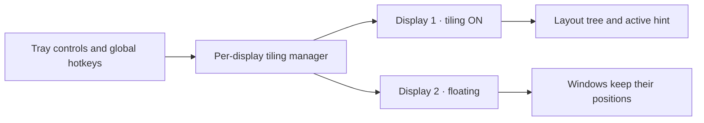

<div align="center">

# ▦ WindowsCosmicTile

**Every display, your own flow.**

A native **Rust + Win32** tiling window manager inspired by COSMIC.<br>
Independent monitors · Visible focus · Keyboard resizing · No web runtime

[](https://github.com/hckmseduardo/WindowsCosmicTile/actions/workflows/build.yml)

[Download preview](https://github.com/hckmseduardo/WindowsCosmicTile/releases/tag/v0.1.0) · [Quick start](docs/QUICKSTART.md) · [Shortcuts](#keyboard-shortcuts) · [Report a bug](https://github.com/hckmseduardo/WindowsCosmicTile/issues/new?template=bug_report.md)

</div>

> **v0.1.0 preview.** Independent project, not affiliated with System76. Native builds are provided for **x64** and **ARM64**. This is a first Windows implementation, not a claim of complete COSMIC feature parity or compatibility with every application.

## Choose your download

| Your computer | Native package |
| --- | --- |
| Intel / AMD 64-bit Windows | [Windows x64 ZIP](https://github.com/hckmseduardo/WindowsCosmicTile/releases/download/v0.1.0/WindowsCosmicTile-v0.1.0-windows-x64.zip) |
| Windows on ARM, including Snapdragon | [Windows ARM64 ZIP](https://github.com/hckmseduardo/WindowsCosmicTile/releases/download/v0.1.0/WindowsCosmicTile-v0.1.0-windows-arm64.zip) |

The ARM64 file is built for `aarch64-pc-windows-msvc`; it is not a renamed x64 executable. Both are 64-bit builds. The app targets current Windows 10/11 desktop systems; Windows 11 is recommended, particularly on ARM. Windows 10 application compatibility has not been interactively validated.

## Features

| Feature | Behavior |
| --- | --- |
| **Independent display switches** | Tile one monitor while leaving another floating. New monitors start off. |
| **Automatic placement** | Horizontal/vertical splits, previous-focus placement, and preference for larger regions when a focused tile is crowded. |
| **Active-window hint** | A transparent, nonactivating outline follows the focused managed window, with cyan, violet and orange colors. |
| **Keyboard layout control** | Focus, swap, resize, rotate a split, float a window and transfer it between displays. |
| **Dialogs stay floating** | Owned modal windows, Save/Open dialog classes, tool windows and fixed-size auxiliary windows are excluded structurally. |
| **Native tray controls** | Notification-area menu, per-display checkmarks, gap controls and keyboard help. |
| **Language choice** | English by default; French and Brazilian Portuguese are available from the tray menu. |
| **Restoration** | Best-effort original placement restoration on disable or normal quit. |
| **No web runtime** | Rust with direct Win32 APIs; the MSVC runtime is linked statically for release builds. |



*The diagram explains the architecture; it is not a Windows screenshot. Live Windows UI screenshots will be added after interactive validation. The separate [Mac version](https://github.com/hckmseduardo/MacCosmicTile) includes native macOS screenshots.*

## Install and first use

1. Download and extract the ZIP matching your CPU architecture.
2. Launch **WindowsCosmicTile.exe**. No installer or administrator permission is required for ordinary apps.
3. Find **WindowsCosmicTile** in the notification area; Windows may place it under the hidden-icons arrow.
4. Open its tray menu and enable the displays you want to tile. Startup defaults to **all displays off**.
5. Press **Ctrl + Alt + T** to toggle the monitor containing the focused window.

The executable is **not Authenticode signed**. SmartScreen can warn about an unknown application. Review the source, build workflow and SHA-256 checksum before deciding whether to run it; the project does not require disabling Windows security features.

### Verify a download

Every release ZIP has a matching `.sha256` file:

```powershell
Get-FileHash .\WindowsCosmicTile-v0.1.0-windows-x64.zip -Algorithm SHA256
```

Compare the hash with the text in the corresponding checksum file.

## Everyday workflows

### Independent monitors

The tray menu lists each connected display by its Windows device ID. Its checkmark means tiling is on.

- **Ctrl + Alt + T** or **Ctrl + Alt + Y** toggles only the focused display.
- If no focused window is available, the monitor under the pointer is used.
- **Ctrl + Alt + Shift + T** enables all displays, or disables all when every connected display is already active.
- Disabling one display restores its managed windows while the others remain active.
- Sending a window to an inactive monitor leaves it floating there.
- Newly attached displays start disabled. Existing enabled displays remain enabled when another is removed.

### Resize with the keyboard

1. Focus a tiled window.
2. Press **Ctrl + Alt + R**.
3. Use **← / →** to reduce/increase width, and **↑ / ↓** to reduce/increase height.
4. Press **Escape**, **Enter**, or **Ctrl + Alt + R** again to exit.

Unmodified arrow keys are captured only while resize mode is active, and are unregistered on exit. Neighboring tiles adjust with the split. If no split exists on an axis, resizing on that axis has no effect.

### Save/Open dialogs

Owned windows and the standard Win32 dialog class `#32770` are excluded, alongside utility, nonresizable, minimized and DWM-cloaked windows. No English-only title matching is used. A custom application's incorrectly exposed dialog may still require manual floating.

### Appearance and language

Use the tray menu to change **Gap**, **Hint color**, or **Active window hint**. Choose **Language → English / Français / Português** for the app's tray labels and action descriptions. Keyboard key names and Windows-provided buttons may follow system conventions.

Gap, hint state/color and language are stored in:

```text
%APPDATA%\WindowsCosmicTile\settings.conf
```

Layout trees, active-display switches and floating-window state are session-only. The app does not install a startup entry or send window metadata over the network.

## Keyboard shortcuts

| Shortcut | Action |
| --- | --- |
| `Ctrl + Alt + T / Y` | Toggle focused display |
| `Ctrl + Alt + Shift + T` | Toggle all displays |
| `Ctrl + Alt + F / G` | Toggle focused window floating |
| `Ctrl + Alt + arrows` | Focus a window in that direction |
| `Ctrl + Alt + Shift + arrows` | Swap with a window in that direction |
| `Ctrl + Alt + R` | Enter/exit resize mode |
| `Left / Right` in resize mode | Reduce/increase width |
| `Up / Down` in resize mode | Reduce/increase height |
| `Escape / Enter` in resize mode | Exit resize mode |
| `Ctrl + Alt + = / -` | Increase/decrease width |
| `Ctrl + Alt + Shift + = / -` | Increase/decrease height |
| `Ctrl + Alt + O` | Rotate the focused window's split |
| `Ctrl + Alt + M` | Move to the next display |
| `Ctrl + Alt + H` | Toggle the active-window hint |

Shortcut registration conflicts are shown in the tray menu. On some keyboard layouts `Ctrl + Alt` is also used by AltGr; configurable shortcuts are planned.

## Build from source

Install a current stable Rust **MSVC** toolchain and Visual Studio Build Tools with the C++ workload and Windows SDK.

```powershell
git clone https://github.com/hckmseduardo/WindowsCosmicTile.git
cd WindowsCosmicTile
cargo test --locked
cargo build --locked --release
.\target\release\WindowsCosmicTile.exe
```

Explicit architecture builds:

```powershell
rustup target add x86_64-pc-windows-msvc aarch64-pc-windows-msvc
cargo build --locked --release --target x86_64-pc-windows-msvc
cargo build --locked --release --target aarch64-pc-windows-msvc
```

Cross-building requires the matching MSVC architecture tools and SDK. The GitHub workflow uses native Windows jobs for x64 and ARM64, runs tests/lint, and checks PE machine types before packaging.

The portable engine can also be tested on macOS/Linux with `cargo test`; the application itself runs only on Windows.

## Architecture

| File | Responsibility |
| --- | --- |
| `src/core.rs` | Pure layout tree, geometry, placement and monitor state |
| `src/i18n.rs` | English canonical UI keys and French/Portuguese translations |
| `src/platform/desktop.rs` | Window discovery, work areas, DWM bounds, placement and restoration |
| `src/platform/manager.rs` | Reconciliation, commands, settings and per-monitor lifecycle |
| `src/platform/indicator.rs` | Click-through outline window and GDI region ownership |
| `src/platform/hotkeys.rs` | Permanent and temporary global hotkeys |
| `src/platform/mod.rs` | Win32 message loop, tray menu and focus-event hook |

The process is per-monitor DPI aware. Geometry comes from `MONITORINFO.rcWork`, and DWM visible bounds compensate for invisible resize borders. A foreground-event hook refreshes state, with roughly 360 ms reconciliation and 120 ms hint polling as fallback. Cross-process positioning is asynchronous, maximized windows are restored before border measurements, and queued transfers have bounded retry state. Stable layouts are not rewritten on every tick. Mouse dragging pauses reconciliation.

## Troubleshooting and limitations

| Symptom | Explanation / next step |
| --- | --- |
| A monitor stays floating | Enable its individual tray switch. New monitors start off. |
| A window refuses movement | Elevated apps may be protected by Windows privilege boundaries; application-specific constraints also apply. |
| Windows overlap | The initial engine uses size heuristics, not a complete minimum-size solver. Reduce window count/gaps, rotate a split, or float an affected window. |
| Arrow keys resize instead of typing | Exit resize mode with Escape or Ctrl + Alt + R. |
| The hint disappears | It hides when focus belongs to an unmanaged window or disabled display. |
| A dialog still tiles | Report its application and reproduction steps; custom dialogs may not expose standard owner/class metadata. |
| A shortcut conflicts | The tray shows registration failures. Check Windows/other-app shortcuts and AltGr behavior. |

No tabbed stacks, drag previews, per-virtual-desktop layout persistence, arbitrary minimum-size constraint solving, or automatic startup installation yet. Minimized/cloaked windows are removed from the active tree and may re-enter at a new position when restored. Manual mouse resizing does not update stored ratios. Forced termination or a crash cannot guarantee restoration. Application compatibility and real multi-monitor/DPI behavior need interactive testing beyond CI compilation.

## Validation and releases

The suite includes 15 portable tests plus 2 Windows-specific restoration-policy tests. Tests cover negative-coordinate geometry, gaps, insertion of newly focused windows, removal, directional resizing, rotation, swaps, independent display activation, display removal, restoration bounds, dialog exclusions, placement, focus direction and language fallback. Both Windows targets are type-checked before publication.

The [build workflow](.github/workflows/build.yml) runs formatting, unit tests, native lint and release builds on x64 and ARM64 Windows jobs. Tagging `v*` publishes portable ZIPs and checksums only after both jobs succeed. Successful hosted builds do not establish interactive desktop behavior on your hardware.

See [CHANGELOG.md](CHANGELOG.md), [CONTRIBUTING.md](CONTRIBUTING.md), [design notes](docs/DESIGN.md), and [release notes](docs/RELEASE_NOTES.md).
